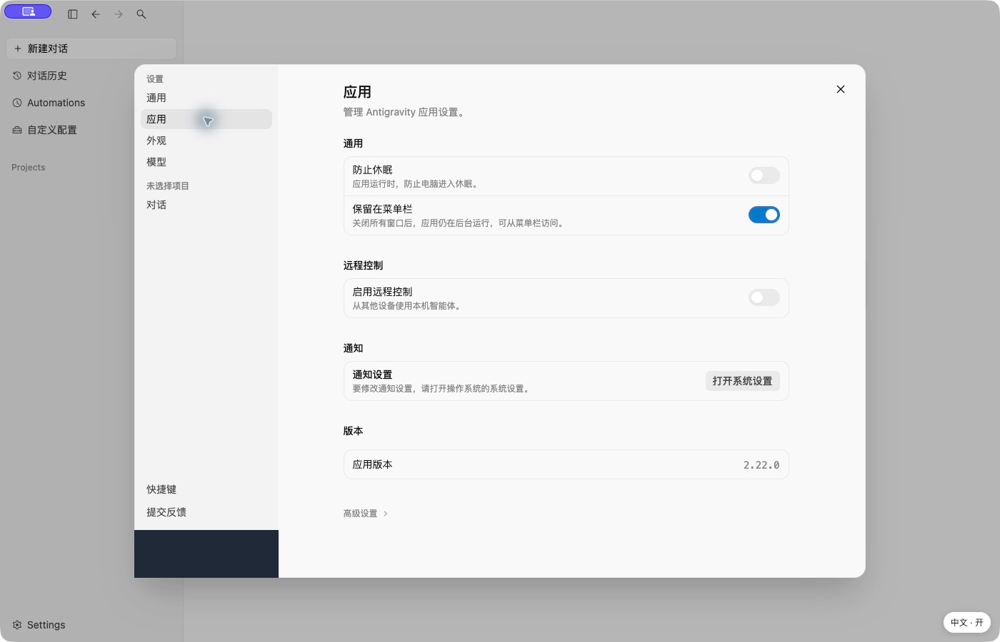
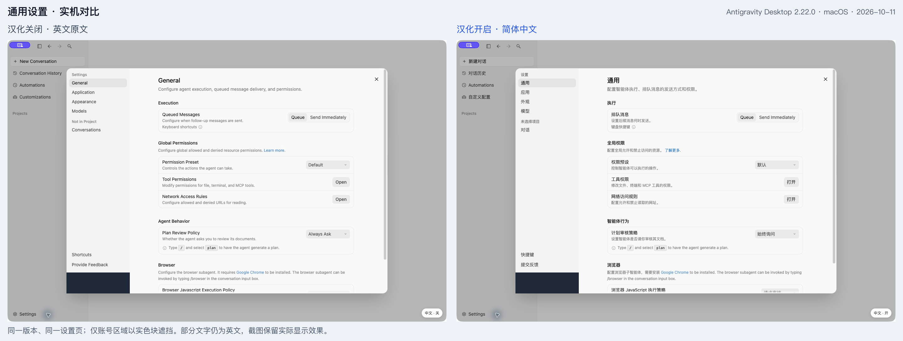
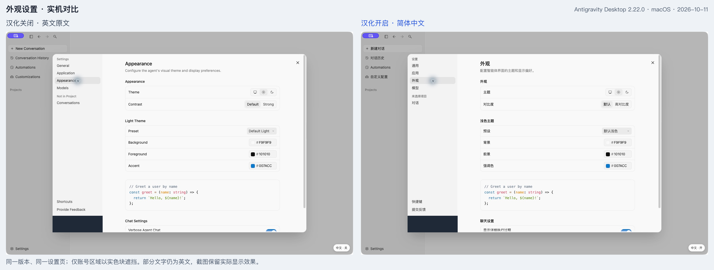

# Antigravity 简体中文汉化补丁

[](https://github.com/zhangsubo/antigravity-chinese-patch/actions/workflows/test.yml)
[](LICENSE)

适用于 **Google Antigravity（反重力）Desktop** 的双模简体中文本地化工具，提供 **Rust 零外部依赖单文件可执行程序 `agy-zh`**，支持**零改包 CDP 动态守护**与**静态 ASAR 安全补丁**两种模式，以及跨窗口中英文实时切换、内置 Swarm 面板隔离汉化和原版无损还原。

本项目由 **[张小璋 / zhangsubo](https://github.com/zhangsubo)** 开发维护，采用 MIT 许可证开源，为非 Google 官方的社区项目。当前已验证支持 **macOS、Linux 与 Windows 上的 Antigravity Desktop**（精确指纹支持 **2.22.0 / 2.23.0 / 2.29.1 / 2.31.2 / 2.32.1**，未收录新版本自动启用结构锚点弹性适配与零改包动态模式）。

**[仓库主页](https://github.com/zhangsubo/antigravity-chinese-patch) · [模式选择与安装](#install) · [自定义词表](#custom-dict) · [更新日志](CHANGELOG.md) · [问题反馈](https://github.com/zhangsubo/antigravity-chinese-patch/issues)**

本仓库于 2026-11-17 从 [zhangsubo/antigravity-zh-cn](https://github.com/zhangsubo/antigravity-zh-cn) 的 `ead9330960b71e1d0d0be65e9996bae38c74ed2d`（版本 `2.32.1.3`）迁入，并在 `3.0.0` 重构为双模架构。

---

## 核心特性

- **双模汉化架构（按需切换，互不冲突）**：
  - **模式一（推荐）：零改包 CDP 动态守护（`agy-zh run` / `agy-zh shortcut`）**——完全不修改 `Antigravity.app` 原包，保留 Google 官方签名与 Apple 公证，客户端自动更新不掉汉化；后台通过 `127.0.0.1` 回环端口动态注入主界面与 Swarm 子帧，支持一键生成桌面快捷方式或 macOS `Antigravity 中文.app`。
  - **模式二：静态 ASAR 安全补丁（`agy-zh install` / `agy-zh restore`）**——内存级二进制 ASAR 分块哈希重写；macOS 使用 APFS 写时复制秒级备份；除主界面与 Swarm 面板外，进一步覆盖 Electron 原生托盘、退出确认框、更新弹窗与会话右键菜单；支持存量 v2（`schema: 1` / `TeacherXuAI`）备份与状态记录 **100% 无损兼容还原**。
- **全面深度词库与 Swarm 面板隔离汉化**：
  - 主界面内置 **1,873 条**精确词条 + **47 条**动态规则，覆盖设置中心、侧边栏、Linux 顶部菜单栏、项目/分支/工作树/模型选择器、自动化（Automations）、自定义配置（Customizations）、权限审批流、追问面板、多智能体实时面板及右侧工具栏。
  - 内置 **Swarm 面板**（`plugin://swarm--swarm_board-<id>/`）专用作用域词库 **142 条** + **7 条**规则，通过 `postMessage` 与主窗口同步中英文切换，严格保护消息正文、成员名、`@all`、`/swarm` 命令与讲述者自定义文案。
- **新一代悬浮控制球与自定义词表**：
  - 可拖拽记忆位置的新版半透明悬浮球，自动贴边防越界，支持多窗口 `localStorage` 实时同步；
  - 右键或双击悬浮球打开配置菜单，可随时一键开启**「选项名保留英文」**预设开关（保留 `This Conversation` / `Request Review` / `Default` / `Auto` / `Turbo` / `High` / `Medium` / `Low` 英文选项名，说明文案照常汉化）；
  - 支持可选本地 `custom-translations.txt` 用户词表（支持自定义译文或置空强制保留英文）。
- **严格防误译边界**：仅作用于受控界面控件，绝不翻译聊天正文、代码与 Diff 内容、输入框、命令参数、项目/分支/技能名称、账号信息或外部登录页。

---

## 双模对比

| 能力维度 | 模式一：零改包动态模式 (`agy-zh run` / `shortcut`) | 模式二：静态 ASAR 安全补丁 (`agy-zh install`) |
| --- | --- | --- |
| 修改原版应用 / 变更签名 | **否**（保留 Google 官方签名与 Apple 公证） | **是**（macOS 需本地 ad-hoc 重签并放宽库校验） |
| 官方自动更新后是否失效 | **不失效**（通过快捷方式或 `run` 启动即生效） | 更新会覆盖补丁（支持 `--replace-stale-backup` 升级） |
| 主界面 DOM / 悬浮球 / 自定义词表 | 完整支持 | 完整支持 |
| 内置 Swarm 面板汉化 | 完整支持（CDP target 注入） | 完整支持（主进程 `did-frame-finish-load` 钩子） |
| 原生退出确认框 / 托盘 / 会话右键菜单 | 不覆盖（受限不改包） | **完整覆盖**（含 2.32.1 `menu.js` / `updater.js` 锚点） |
| 启动方式 | `agy-zh run` 或双击 `Antigravity 中文.app` / 快捷方式 | 直接双击原版 `Antigravity` 图标 |

---

## 汉化效果

以下为同一版本应用中关闭与开启汉化的实机对比。左侧为英文原文，右侧为中文显示，页面设置值保持一致。

[](docs/images/application-comparison.png)

<details>
<summary>查看中文界面及更多对比</summary>

### 应用设置



### 通用设置



### 外观设置



</details>

截图采集于 2026-10-11，环境为 macOS 26.5.2 / Apple Silicon / Antigravity Desktop 2.22.0。完整窗口仅遮挡账号区域，未重绘或修改界面文字。

[查看完整图集与采集说明](docs/SCREENSHOTS.md) · [查看测试记录](docs/VALIDATION.md)

---

## 兼容性

| 项目 | 支持情况 |
| --- | --- |
| 工具版本 | 标准 SemVer **`3.0.0`**（单文件 Rust 宿主 `agy-zh`） |
| 已验证版本 | Google Antigravity Desktop **2.22.0 / 2.23.0 / 2.29.1 / 2.31.2 / 2.32.1** |
| 未收录新版本 | 自动启用**结构锚点弹性注入**（静态模式）与 **CDP 动态注入**（动态模式） |
| 操作系统与架构 | macOS（Apple Silicon / Intel）、Linux（x64 / arm64）、Windows（x64 / arm64） |
| 运行期依赖 | **零依赖**（单文件可执行程序 `agy-zh`，无需安装 Python 或 Node.js） |
| Antigravity IDE / VS Code | **不支持**（自动检测并拒绝 IDE 包） |

---

## 安全说明

1. **零改包动态模式（`agy-zh run` / `agy-zh shortcut`）**：
   - 不修改任何原始应用文件，不更改签名与公证；
   - 仅使用 `--remote-debugging-port=<port> --remote-debugging-address=127.0.0.1` 绑定本地回环接口，**绝不启用**高危 `--remote-allow-origins=*`；
   - 仅注入受检的本地页面与 `plugin://swarm--swarm_board-*` 子帧，不触碰外部登录页面（如 `accounts.google.com`）与内置浏览器普通网页，不在日志中记录包含鉴权参数的 URL 查询串。
2. **静态 ASAR 安全补丁（`agy-zh install`）**：
   - **安装会修改应用包内的 `app.asar`，在 macOS 上将外层签名替换为本地 ad-hoc 签名并附加 `com.apple.security.cs.disable-library-validation` 权限**，以加载原有 Google 框架；命令中的 `--acknowledge-signature-change` 与 `--allow-local-library-loading` 用于显式确认上述两项安全变化；
   - 安装器不关闭系统 Gatekeeper 或 Hardened Runtime，不移除隔离属性，不修改 Electron 安全开关；
   - 原版应用与恢复记录保存在应用旁边：`<App>.zh-cn-original` 与 `<App>.zh-cn-state.json`，请勿删除或直接双击备份包。
3. **老版本用户平滑迁移**：
   - 若你此前已通过 v2 `tools/patcher.py` 安装过补丁，新版 `agy-zh` 可直接通过 `doctor` 识别旧版 `legacy-v2` 标记与 `schema: 1` 备份，并支持直接执行 `agy-zh restore` 一键无损还原为 Google 原版后再切换动态或新版静态模式。

补丁不读取账号凭据、不上传对话、不收集遥测，翻译逻辑完全本地离线执行。

---

<a id="install"></a>

## 安装与使用指南

### 1. 获取单文件程序 `agy-zh`

- **方式 A（推荐）：下载预编译单文件二进制**
  从 [GitHub Releases](https://github.com/zhangsubo/antigravity-chinese-patch/releases) 下载对应平台产物（可结合 `SHA256SUMS.txt` 校验完整性）：
  - macOS Apple Silicon：`agy-zh-macos-arm64`
  - macOS Intel：`agy-zh-macos-x64`
  - Linux x64 / ARM64：`agy-zh-linux-x64` / `agy-zh-linux-arm64`
  - Windows x64 / ARM64：`agy-zh-windows-x64.exe` / `agy-zh-windows-arm64.exe`

  macOS / Linux 下载后赋予执行权限（若 macOS 提示来自互联网未签名二进制，可先执行 `xattr -d com.apple.quarantine ./agy-zh`）：
  ```bash
  chmod +x ./agy-zh-macos-arm64
  mv ./agy-zh-macos-arm64 ./agy-zh
  ```

- **方式 B：从源码编译**
  需 Node.js **20+** 与 Rust **1.80+**：
  ```bash
  git clone https://github.com/zhangsubo/antigravity-chinese-patch.git
  cd antigravity-chinese-patch
  npm ci --ignore-scripts
  npm run build   # 先编译验证 JS 载荷，再构建 target/release/agy-zh
  ```

直接无参数运行 `./agy-zh` 也可进入**交互式中文菜单**，按数字提示完成全部操作。

---

### 2. 模式一：零改包动态守护（推荐）

请先完全退出正在运行的 Antigravity 客户端（macOS 按 `⌘Q`）：

```bash
# 1) 直接以动态模式启动 Antigravity 并在后台常驻守护（客户端退出后自动退出）
./agy-zh run

# 2) 一键生成桌面/启动台快捷方式（以后直接双击「Antigravity 中文」即可，无需开终端）
./agy-zh shortcut

# 3) 仅停止后台守护进程（不关闭客户端）
./agy-zh stop

# 4) 如需移除快捷方式
./agy-zh shortcut --remove
```

- 自定义安装目录可通过 `--app <应用路径>` 指定；
- 若用户此前已经用静态补丁修改过应用，建议先运行 `./agy-zh restore` 恢复 Google 原版签名，再使用动态模式。

---

### 3. 模式二：静态 ASAR 安全补丁

#### 第一步：只读诊断（`doctor`）

```bash
# macOS（默认检查 /Applications/Antigravity.app）或 Linux / Windows 自动探测
./agy-zh doctor

# 指定自定义路径
./agy-zh doctor --app /path/to/Antigravity
```

#### 第二步：安装补丁（`install`）

完全退出 Antigravity Desktop（macOS 按 `⌘Q`，Linux/Windows 确保主进程与 `language_server` 均已退出）：

- **macOS**：确认接受[安全说明](#安全说明)后执行：
  ```bash
  ./agy-zh install --acknowledge-signature-change --allow-local-library-loading
  ```
- **Linux / Windows**：
  ```bash
  ./agy-zh install
  ```
- 若 Antigravity 自动更新覆盖了旧版已打补丁应用，`doctor` 会显示 `stale_backup_version`；此时在安装命令后追加 `--replace-stale-backup` 即可安全更新备份并重打补丁。

#### 第三步：无损还原（`restore`）

完全退出 Antigravity 后执行（同时兼容还原 v2 存量备份）：

```bash
./agy-zh restore
```

---

### 4. 悬浮球交互与快捷键

- **单击右下角悬浮球（`中` / `EN`）**：实时切换主界面、所有同源窗口及内置 Swarm 面板的中英文；
- **拖拽悬浮球**：移动到屏幕任意角落并自动记住位置（窗口大小变化时自动吸附防越界）；
- **右键或双击悬浮球**：打开配置菜单，可勾选 **「选项名保留英文」**（如保留 `Auto`、`Turbo`、`Default`、`Request Review`、`High`、`Medium`、`Low` 等模式名），并可查看当前运行模式（静态补丁 / CDP 动态）与版本号。

---

<a id="custom-dict"></a>

## 自定义词表（`custom-translations.txt`）

如希望覆写特定翻译或强制保留某些词条为英文，可在以下默认路径创建 `custom-translations.txt`（也可通过 `run` / `install` 的 `--custom-translations <PATH>` 参数指定）：

- **macOS**：`~/Library/Application Support/antigravity-chinese-patch/custom-translations.txt`
- **Linux**：`${XDG_CONFIG_HOME:-~/.config}/antigravity-chinese-patch/custom-translations.txt`
- **Windows**：`%APPDATA%\antigravity-chinese-patch\custom-translations.txt`（需显式附加 `--trust-custom-translations` 才加载）

文件格式（UTF-8，大小上限 512 KB，Unix 建议权限 `chmod 600`）：

```ini
# 覆写已有翻译
Settings = 系统设置

# 等号右侧留空：强制保留英文原文
Auto =
Request Review =
```

为防止注入风险，词表仅作为纯 JSON 数据传入翻译器，拒绝包含 `<` 或 `>` 的译文以及软链接、宽松权限文件。

---

## 仓库结构与开发测试

开发环境要求 Node.js **20+**、npm 和 Rust **1.80+**。

```bash
npm ci --ignore-scripts
npm run build:payloads   # 校验 6 道词库门禁并确定性生成 dist/
npm test                 # 运行 build:payloads + 35 项 JS 测试 + Rust 单元测试
cargo build --release    # 构建单文件 target/release/agy-zh
```

### 检测官方新版本漂移

```bash
npm run scan:drift -- /Applications/Antigravity.app.zh-cn-original/Contents/Resources/app.asar --report tools/drift-report.json
```

### 目录说明

| 路径 | 用途 |
| --- | --- |
| `locales/src/` | 分层主界面词库（`core/`、`views/`）与声明式正则规则（`rules/patterns.json`） |
| `locales/scoped/swarm.json` | 内置 Swarm 面板独立作用域词库与防误译白名单 |
| `src/shared/` | 统一常量命名空间与四级优先级翻译引擎 |
| `src/runtime/` | 主界面扫描器、边界守卫、原生右键菜单拦截与新一代悬浮球 |
| `src/swarm/` | Swarm 子帧独立运行时与 Electron 主进程 `did-frame-finish-load` 钩子 |
| `tools/build-payloads.mjs` | 6 道词库质量门禁编译器与确定性 JS 载荷打包器 |
| `tools/drift-detector.mjs` | 官方前端 Bundle / ASAR 文本漂移扫描器 |
| `tools/compatibility.json` | Schema v2 兼容清单（已验证版本指纹 + 结构锚点规则） |
| `rust-src/` | Rust 单文件宿主引擎（ASAR、APFS 克隆、重签、CDP 守护、快捷方式、CLI） |
| `dist/` | 由编译器生成的确定性内嵌 JS/JSON 载荷（供 `build.rs` 编译期静态内嵌） |
| `tests/` | JS DOM 回归测试、Swarm 隔离测试、门禁与漂移测试（另有 Rust `#[cfg(test)]` 套件） |

修改源码或词库后请运行 `npm test` 并提交 `dist/` 更新；具体规范见 [贡献指南](CONTRIBUTING.md)。

---

## 更新日志

版本变更记录见 [CHANGELOG.md](CHANGELOG.md) 与 [验证记录](docs/VALIDATION.md)。

## 问题反馈

请通过 [GitHub Issues](https://github.com/zhangsubo/antigravity-chinese-patch/issues) 提交安装问题、翻译修正或功能建议，并提供：

- 操作系统版本（macOS / Linux / Windows）、处理器架构及 Antigravity 版本；
- `agy-zh --version` 输出、`agy-zh doctor` 脱敏结果、操作步骤及完整报错；
- 已遮挡个人信息的相关截图。

请勿提交账号凭据、邮箱、登录二维码、私人对话、完整应用文件或个人目录。

## 许可证

本项目代码采用 [MIT License](LICENSE)。Google Antigravity 的名称、图标、软件及相关权利归各自权利方所有。本项目为非官方社区维护项目，不代表 Google。

## 致谢

- 本项目最初基于原仓库 [TeacherXuAI/antigravity-zh-cn](https://github.com/TeacherXuAI/antigravity-zh-cn) 演进开发，感谢原作者提供的早期架构与基础词库支持。
- `3.0.0` 双模架构重构吸收了社区优秀工程实践（分层词库与 Swarm 作用域隔离、零改包 CDP 动态守护与单文件宿主分发）。
- 感谢 [Linux.do](https://linux.do) 里的各位大佬的帖子，让我搞定 Antigravity 的登录和使用。
