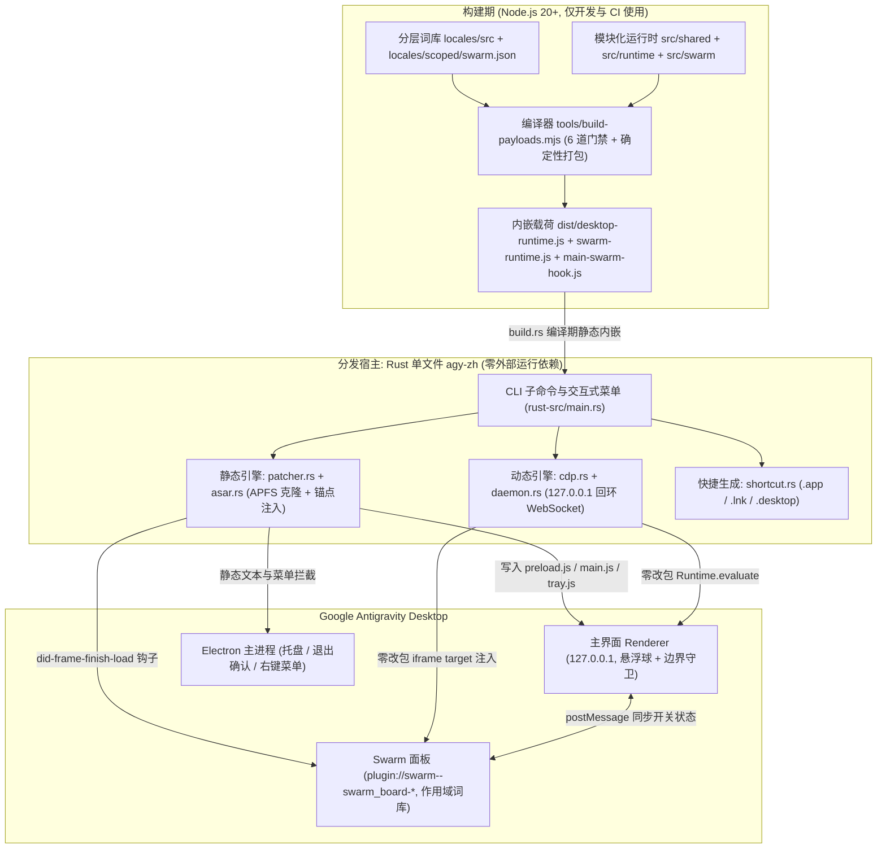
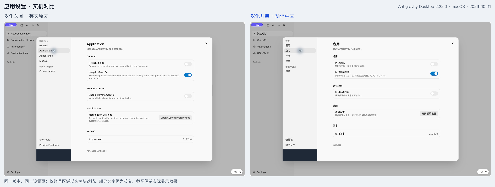

# Antigravity 简体中文汉化补丁

[](https://github.com/zhangsubo/antigravity-chinese-patch/actions/workflows/test.yml)
[](LICENSE)

适用于 **Google Antigravity（反重力）Desktop** 的双模简体中文本地化工具，提供 **Rust 零外部依赖单文件可执行程序 `agy-zh`**（macOS arm64 Release 实测约 **1.6 MB**，无需 Python 或 Node.js 运行环境），支持**零改包 CDP 动态守护**与**静态 ASAR 安全补丁**两种模式，以及跨窗口中英文实时切换、内置 Swarm 面板隔离汉化和原版无损还原。

本项目由 **[张小璋 / zhangsubo](https://github.com/zhangsubo)** 开发维护，采用 MIT 许可证开源，为非 Google 官方的社区项目。当前已验证支持 **macOS、Linux 与 Windows 上的 Antigravity Desktop**（精确指纹支持 **2.22.0 / 2.23.0 / 2.29.1 / 2.31.2 / 2.32.1 / 2.32.2 / 2.33.0 / 2.33.1 / 2.34.0 / 2.35.0 / 2.35.2**，其中 `2.35.2` 已在 Linux x64 与 Windows 11 x64 桌面实测验证，macOS 已核验 2.35.2 官方包指纹、桌面实测待完成；`2.33.1` 与 `2.34.0` 已在 macOS arm64 和 Linux x64 桌面验证。未收录新版本自动启用结构锚点弹性适配与零改包动态模式）。

**[仓库主页](https://github.com/zhangsubo/antigravity-chinese-patch) · [架构与双模对比](#architecture) · [安装与使用指南](#install) · [命令速查](#cli) · [自定义词表](#custom-dict) · [更新日志](CHANGELOG.md) · [问题反馈](https://github.com/zhangsubo/antigravity-chinese-patch/issues)**

本仓库于 2026-11-17 从 [zhangsubo/antigravity-zh-cn](https://github.com/zhangsubo/antigravity-zh-cn) 的 `ead9330960b71e1d0d0be65e9996bae38c74ed2d`（版本 `2.32.1.3`）迁入，使用独立提交历史，并在 **`3.0.0`** 重构为双模架构。历史发布包可参阅[旧仓库 Releases](https://github.com/zhangsubo/antigravity-zh-cn/releases)。

---

## 功能特性

- **双模汉化架构（按需切换，互不冲突）**：
  - **模式一（推荐）：零改包 CDP 动态守护（`agy-zh run` / `agy-zh shortcut`）**——完全不修改 `Antigravity.app` 原包，保留 Google 官方签名与 Apple 公证，客户端更新后可用中文快捷方式或 `agy-zh run` 重新启动汉化；在 Linux `/opt` 或 Windows `Program Files` 等系统目录安装原版时也**无需 `sudo` 或管理员权限**即可运行；支持一键生成 macOS `Antigravity 中文.app`、Windows 桌面 `.lnk` 或 Linux `.desktop` 快捷方式。
  - **模式二：静态 ASAR 安全补丁（`agy-zh install` / `agy-zh restore`）**——内存级二进制 ASAR 分块 SHA-256 重写；macOS 升级为 APFS 写时复制秒级备份（失败回退 `ditto`）；除主界面与 Swarm 面板外，进一步覆盖 Electron 原生托盘、退出确认框、更新提示与会话右键菜单；支持存量 v2（`schema: 1` / `TeacherXuAI`）备份与状态记录 **100% 无损兼容还原**。
- **五大覆盖域深度汉化（主界面 2,337 条精确词条 + 64 条动态规则；Swarm 面板 156 条专用词条 + 11 条规则）**：
  - **设置中心**：账户、通用（含语音模式）、应用、外观、浏览器、界面布局、快捷键、通知、模型与用量、定制化（含插件云端连接与多账号说明）、意见反馈、项目与运行环境（含环境初始化脚本验证）等全部设置页与悬停说明；
  - **主界面与导航**：侧边栏（含协调器与扩展显示筛选）、Linux 顶部自定义菜单栏（`title-menu-bar`：工作区 / 视图 / 窗口、检查更新、命令面板、最小化/最大化/关闭与动态版本号）、首次启动登录引导页、创建项目向导弹窗（本地/云端远程切换、文件夹与资源选择、项目命名与重复检测）、项目与分支/工作树选择器（含新建工作树、SSH 远程主机、连接弹窗、机器切换器与 GitHub 仓库入口）、模型选择器与配额浮层（含 `新`/`快速`/`提示` 胶囊及 `本周额度`/`5 小时额度`/`剩余 %`）、主面板「自动化（Automations）」及「自定义配置（Customizations）」插件市场与已安装视图；
  - **对话流与右侧面板**：权限审批卡片（含下载审批详情、可编辑权限目标与 macOS 辅助功能/屏幕录制权限引导卡）、对话级权限预设选择器与沙盒提示、外部资源选择器（Google Drive / GitHub）、选中引用/评论/追问（`/btw`）浮条、追问（Side Question）面板控件、多智能体实时画面面板（Multi-Agent Live Pane）、计划审阅栏、思考折叠头，以及侧边面板标签栏、终端、代码变更（Diff）、内置浏览器（含地址栏评论草稿胶囊、评论草稿编辑框与下载进度）、文件树与 CSV 查看器外围工具栏（含「在文件管理器中显示 / 在访达中显示 / 在文件资源管理器中显示」）；
  - **内置 Swarm 协作面板（v3.0 新增）**：独立作用域覆盖 `plugin://swarm--swarm_board-<id>/` 文档帧（概览、看板、成员、@提及关系图、原始数据、筛选器、回放控制与新手引导），通过 `postMessage` 与主窗口实时同步中英文切换，严格保护 `#swarm-title`、`.msg-body`、成员名、`@all`、`/swarm` 命令与讲述者 `SwarmHive.viewCopy` 自定义文案；
  - **Electron 原生组件（静态补丁模式）**：会话右键菜单（含子菜单与 SSH 远程窗口复用）、原生退出确认弹窗、状态栏托盘菜单，以及 2.32.1 菜单与自动更新提示锚点（`dist/menu.js` / `dist/updater.js`）。
- **新一代悬浮控制球与自定义词表**：
  - 可拖拽记忆位置的新版半透明悬浮球（`[data-agy-zh-control]`），随窗口缩放自动贴边防越界，并通过 `localStorage` 实现多窗口实时状态同步；
  - 右键或双击悬浮球打开配置菜单，可随时开启**「选项名保留英文」**预设开关（保留 `This Conversation` / `Request Review` / `Default` / `Auto` / `Turbo` / `High` / `Medium` / `Low` 英文选项名，说明文案照常汉化），并查看当前运行模式与版本；
  - 支持可选本地 `custom-translations.txt` 用户自定义词表（支持译文覆写或置空强制保留英文）。
- **严格防误译边界**：仅作用于受控界面控件，不翻译聊天正文、代码与 Diff 内容、输入框、命令参数、项目/分支/技能名称、账号信息或外部登录页。

---

<a id="architecture"></a>

## 架构与双模对比



| 能力维度 | 模式一：零改包动态模式 (`agy-zh run` / `shortcut`) | 模式二：静态 ASAR 安全补丁 (`agy-zh install`) |
| --- | --- | --- |
| 修改原版应用 / 变更签名 | **否**（保留 Google 官方签名与 Apple 公证） | **是**（macOS 需本地 ad-hoc 重签并放宽库校验） |
| 管理员 / `sudo` 权限需求 | **通常无需**（不改动 `/Applications`、`/opt` 或 `Program Files`） | 修改系统安装目录时需对应写入权限（`sudo` / 管理员终端） |
| 官方自动更新后是否失效 | 完全退出更新后的客户端，通过中文快捷方式或 `run` 重新启动 | 更新会覆盖补丁（支持 `--replace-stale-backup` 升级） |
| 主界面 DOM / 悬浮球 / 自定义词表 | 完整支持 | 完整支持 |
| 内置 Swarm 面板汉化 | 完整支持（CDP target 注入） | 完整支持（主进程 `did-frame-finish-load` 钩子） |
| 原生退出确认框 / 托盘 / 右键菜单 | 不覆盖（受限不改包） | **完整覆盖**（含 2.32.1 `menu.js` / `updater.js` 锚点） |
| 启动方式 | `agy-zh run` 或双击 `Antigravity 中文` 快捷方式 | 直接双击原版 `Antigravity` 图标 |

---

## 汉化效果

以下为同一版本应用中关闭与开启汉化的实机对比。左侧为英文原文，右侧为中文显示，页面设置值保持一致。

[](docs/images/application-comparison.png)

<details>
<summary>查看中文界面及更多对比</summary>

### 应用设置


### 通用设置


### 外观设置


</details>

截图采集于 2026-10-11，环境为 macOS 26.5.2 / Apple Silicon / Antigravity Desktop 2.22.0。完整窗口仅遮挡账号区域，未重绘或修改界面文字。

[查看完整图集与采集说明](docs/SCREENSHOTS.md) · [查看测试记录](docs/VALIDATION.md)

---

## 兼容性

| 项目 | 支持情况 |
| --- | --- |
| 工具版本 | 标准三段式 SemVer **`3.0.6`**（单文件 Rust 宿主 `agy-zh`） |
| 已精确验证版本 | Google Antigravity Desktop **2.22.0 / 2.23.0 / 2.29.1 / 2.31.2 / 2.32.1 / 2.32.2 / 2.33.0 / 2.33.1 / 2.34.0 / 2.35.0 / 2.35.2**（Linux x64 与 Windows 11 x64 实测至 **2.35.2**；macOS arm64 实测至 **2.34.0**、**2.35.0–2.35.2** 待手测） |
| 未收录新版本 | 自动启用**结构锚点弹性注入**（静态模式）与 **CDP 动态守护**（动态模式） |
| 操作系统与架构 | Apple Silicon Mac、Linux x86_64、Windows 11 x64 已实测；Intel Mac / Linux arm64 / Windows arm64 提供官方构建产物，欢迎实机反馈 |
| 运行期依赖 | **零依赖**（单文件可执行程序 `agy-zh`，无需安装 Python 或 Node.js） |
| Antigravity IDE / VS Code | **不支持**（校验 `CFBundleIdentifier` / `package.json` / `engines.vscode`，自动拒绝 IDE 包） |

### 默认安装路径探测与快捷方式位置

不传 `--app` 时，`agy-zh` 按以下顺序自动探测 Antigravity Desktop 真实目录（拒绝符号链接与 Windows Junction）：

- **macOS**：`/Applications/Antigravity.app` → `~/Applications/Antigravity.app`
  （`shortcut` 默认生成至 `/Applications/Antigravity 中文.app`，无写入权限时回退 `~/Applications/Antigravity 中文.app`）
- **Linux**：`/opt/Antigravity` → `/opt/antigravity` → `/usr/share/antigravity` → `/usr/lib/antigravity` → `~/.local/share/antigravity` → `~/Antigravity-x64` → `~/Antigravity-arm64` → `~/Antigravity` → `PATH` 中真实 `antigravity` 所在目录
  （`shortcut` 默认生成至 `${XDG_DATA_HOME:-~/.local/share}/applications/antigravity-zh.desktop`）
- **Windows**：`%LOCALAPPDATA%\Programs\Antigravity` → `%LOCALAPPDATA%\Antigravity` → `%ProgramFiles%\Antigravity` → `%ProgramFiles(x86)%\Antigravity` → `PATH` 中真实 `Antigravity.exe` 所在目录
  （`shortcut` 默认在桌面生成 `Antigravity 中文.lnk`）

---

<a id="安全说明"></a>

## 安全说明

1. **零改包动态模式（`agy-zh run` / `agy-zh shortcut`）**：
   - 不修改任何原始应用文件，保留 Google 官方签名与 Apple 公证；
   - 仅使用 `--remote-debugging-port=<port> --remote-debugging-address=127.0.0.1` 绑定本地回环接口，**绝不启用**高危 `--remote-allow-origins=*`；
   - 桌面汉化载荷用于核验过宿主特征的本机界面，Swarm 载荷用于 `plugin://swarm--swarm_board-*` 子帧。macOS Desktop 2.34.0 的原生 Passkey 窗口按模板指纹识别，连接提示随主窗口语言切换。其余页面继续按来源过滤，跳过外部登录页（如 `accounts.google.com`）与内置浏览器打开的无关本地开发服务，且日志绝不输出含鉴权参数的 URL 查询串。
2. **静态 ASAR 安全补丁（`agy-zh install`）**：
   - **安装会修改应用包内的 `app.asar`，在 macOS 上将外层签名替换为本地 ad-hoc 签名并附加 `com.apple.security.cs.disable-library-validation` 权限**，以加载原有 Google 框架；安装命令中的 `--acknowledge-signature-change` 与 `--allow-local-library-loading` 用于显式确认上述两项安全变化；
   - 安装器不关闭系统 Gatekeeper 或 Hardened Runtime，不移除隔离属性，不修改 Electron 安全开关；
   - 原版应用与恢复记录保存在应用旁边：`<App>.zh-cn-original` 与 `<App>.zh-cn-state.json`，请勿删除或直接双击备份包；路径校验拒绝符号链接、Windows 目录联接（Junction）与逃逸软链。
3. **老版本用户平滑迁移**：
   - 若此前曾使用 v2 `tools/patcher.py` 安装过补丁，新版 `agy-zh` 可通过 `doctor` 直接识别 `legacy-v2` 标记与 `schema: 1` 备份，并支持直接执行 `agy-zh restore` 一键无损还原为 Google 原版后再切换动态模式或新版静态补丁。

补丁不读取账号凭据、不上传对话、不收集遥测，翻译逻辑完全本地离线执行。

---

<a id="install"></a>

## 安装与使用指南

### 1. 获取并管理 `agy-zh`

- **方式 A（推荐）：一键安装与维护脚本（自动安装/更新、`agy-zh-*` 本地迁移重命名、一键 CDP/ASAR、状态与卸载）**
  - **macOS / Linux**：
    - 在线一键安装（自动校验 `SHA256SUMS.txt`，默认安装到 `~/.local/bin/agy-zh` 与 `~/.local/bin/agy-zh-manage` 并写入 `PATH`）：
      ```bash
      curl -fsSL https://github.com/zhangsubo/antigravity-chinese-patch/releases/latest/download/agy-zh-manage.sh | bash
      ```
    - 或从 [GitHub Releases](https://github.com/zhangsubo/antigravity-chinese-patch/releases) 下载 `agy-zh-manage.sh`（可与 `agy-zh-*` 放在同一目录直接运行，脚本会自动识别并迁移重命名为 `agy-zh`）：
      ```bash
      bash agy-zh-manage.sh
      # 常用快捷命令（安装后可直接运行 agy-zh-manage）：
      # agy-zh-manage --mode cdp                        # 一键部署 CDP 动态汉化与快捷方式
      # agy-zh-manage --stop --remove-shortcut          # 停止 CDP 守护并移除中文快捷方式
      # agy-zh-manage --mode asar                       # 一键安装静态 ASAR 补丁
      # agy-zh-manage --install-dir ~/my-bin --from ./agy-zh-macos-arm64 --delete-source
      # agy-zh-manage --update                          # 更新 agy-zh 并自动刷新已有快捷方式
      # agy-zh-manage --mirror https://your-mirror      # 配置并记住下载加速镜像（none 清除）
      # agy-zh-manage --status / --logs / --uninstall   # 查看状态、日志或彻底卸载
      ```
  - **Windows (PowerShell / CMD)**：
    - 在线一键安装（默认安装到 `%LOCALAPPDATA%\Programs\agy-zh`，自动写入用户 `PATH`）：
      ```powershell
      irm https://github.com/zhangsubo/antigravity-chinese-patch/releases/latest/download/agy-zh-manage.ps1 -OutFile "$env:TEMP\agy-zh-manage.ps1"; & "$env:TEMP\agy-zh-manage.ps1"
      ```
    - 或从 [GitHub Releases](https://github.com/zhangsubo/antigravity-chinese-patch/releases) 下载 `agy-zh-manage.ps1` 与 `agy-zh-manage.cmd`（同目录有 `agy-zh-windows-*.exe` 时会自动提示迁移并重命名为 `agy-zh.exe`），直接双击 `agy-zh-manage.cmd` 打开中文维护菜单，或在终端执行：
      ```powershell
      .\agy-zh-manage.cmd -Mode cdp
      .\agy-zh-manage.cmd -Stop -RemoveShortcut
      .\agy-zh-manage.cmd -InstallDir "D:\Tools\agy-zh" -From ".\agy-zh-windows-x64.exe" -DeleteSource
      .\agy-zh-manage.cmd -Update
      .\agy-zh-manage.cmd -Status
      .\agy-zh-manage.cmd -Uninstall
      ```

- **方式 B：手动下载预编译单文件二进制**
  从 [GitHub Releases](https://github.com/zhangsubo/antigravity-chinese-patch/releases) 下载对应平台产物（可结合 `SHA256SUMS.txt` 校验 SHA-256）：
  - macOS Apple Silicon：`agy-zh-macos-arm64`
  - macOS Intel：`agy-zh-macos-x64`
  - Linux x64 / ARM64：`agy-zh-linux-x64` / `agy-zh-linux-arm64`
  - Windows x64 / ARM64：`agy-zh-windows-x64.exe` / `agy-zh-windows-arm64.exe`

  - **macOS / Linux**：
    ```bash
    chmod +x ./agy-zh-*
    mv ./agy-zh-* ./agy-zh
    # 若 macOS 提示来自互联网的未签名二进制拦截，可执行：
    xattr -d com.apple.quarantine ./agy-zh
    ```
  - **Windows (PowerShell)**：
    ```powershell
    Rename-Item .\agy-zh-windows-x64.exe agy-zh.exe
    ```

- **方式 C：从源码编译**
  需 Node.js **20+** 与 Rust **1.80+**：
  ```bash
  git clone https://github.com/zhangsubo/antigravity-chinese-patch.git
  cd antigravity-chinese-patch
  npm ci --ignore-scripts
  npm run build   # 先校验词库门禁并生成 dist/，再编译 target/release/agy-zh
  ```

直接无参数运行 `./agy-zh`（Windows 为 `.\agy-zh.exe`）可进入**交互式中文菜单**，按数字提示完成全部操作。

---

### 2. 模式一：零改包动态守护（推荐）

请先完全退出正在运行的 Antigravity Desktop（macOS 按 `⌘Q`，Windows/Linux 确保托盘与 `language_server` 均已退出）：

- **macOS / Linux**：
  ```bash
  # 1) 以动态模式启动 Antigravity 并在后台常驻守护（客户端退出后自动退出）
  ./agy-zh run

  # 2) 一键生成快捷方式（以后直接双击「Antigravity 中文」即可，无需再开终端）
  ./agy-zh shortcut

  # 3) 仅停止后台守护进程（不关闭 Antigravity 客户端）
  ./agy-zh stop

  # 4) 如需移除快捷方式
  ./agy-zh shortcut --remove
  ```
- **Windows (PowerShell)**：
  ```powershell
  .\agy-zh.exe run
  .\agy-zh.exe shortcut
  .\agy-zh.exe stop
  .\agy-zh.exe shortcut --remove
  ```

- 自定义安装目录可通过 `--app <应用路径>` 指定；后台运行日志保存于 `~/Library/Logs/antigravity-chinese-patch.log`（macOS）、`${XDG_RUNTIME_DIR:-~/.cache}/antigravity-chinese-patch/antigravity-chinese-patch.log`（Linux）或 `%LOCALAPPDATA%\antigravity-chinese-patch\antigravity-chinese-patch.log`（Windows）。
- 若此前使用静态补丁修改过应用，建议先运行 `agy-zh restore` 恢复 Google 原版签名，再使用动态模式。

---

### 3. 模式二：静态 ASAR 安全补丁

#### 第一步：只读诊断（`doctor`）

```bash
# macOS / Linux（支持 --app /path/to/Antigravity 指定自定义目录）
./agy-zh doctor
```

```powershell
# Windows（自动探测常见安装路径，也支持 --app "C:\path\to\Antigravity"）
.\agy-zh.exe doctor
```

该命令为只读检查，输出应用版本、平台类型、兼容模式（`verified` / `anchor_fallback`）、汉化代数（`v3` / `legacy-v2`）、Swarm 钩子状态、锚点命中详情及旧备份版本提示。

#### 第二步：安装补丁（`install`）

完全退出 Antigravity Desktop 后执行：

- **macOS**：按 `⌘Q` 完全退出，确认接受[安全说明](#安全说明)中的签名与权限变化后执行：
  ```bash
  ./agy-zh install --acknowledge-signature-change --allow-local-library-loading
  ```
- **Linux**：完全退出 `antigravity` 与 `language_server` 进程后执行（若安装于 `/opt/Antigravity` 等系统目录请使用 `sudo`）：
  ```bash
  ./agy-zh install
  # 或指定自定义目录：
  ./agy-zh install --app /path/to/Antigravity-x64
  ```
- **Windows (PowerShell)**：完全退出托盘、`Antigravity.exe` 与 `language_server.exe` 后执行（若安装于 `Program Files` 请以管理员身份运行终端）：
  ```powershell
  .\agy-zh.exe install
  # 或指定自定义目录：
  .\agy-zh.exe install --app "C:\path\to\Antigravity"
  ```
- **客户端更新后升级补丁**：若官方更新覆盖了旧版已打补丁应用，`doctor` 会输出 `stale_backup_version`；此时在安装命令后追加 `--replace-stale-backup`，工具会在核验旧备份完整后事务性替换为新版备份。

#### 第三步：无损还原（`restore`）

完全退出 Antigravity 后执行（同时兼容还原 v2 `schema: 1` 存量备份；自定义路径需传入与安装时相同的 `--app`）：

```bash
# macOS / Linux（若静态补丁安装在系统目录且原需 sudo，请配合 sudo）
./agy-zh restore
```

```powershell
# Windows
.\agy-zh.exe restore
```

如果应用在打补丁后已被官方更新覆盖，还原会自动停止以避免旧版备份覆盖新版。

---

### 4. 悬浮球交互与功能开关

- **单击右下角悬浮球（`中` / `EN`）**：实时切换主界面、所有同源窗口及内置 Swarm 面板的中英文；
- **拖拽悬浮球**：移动到屏幕任意角落并自动记住位置（窗口大小变化时自动吸附防越界）；
- **右键或双击悬浮球**：打开配置菜单，可勾选 **「选项名保留英文」**（保留 `This Conversation`、`Request Review`、`Default`、`Auto`、`Turbo`、`High`、`Medium`、`Low` 等模式选项名，说明文案照常翻译），并可查看当前运行模式（静态补丁 / CDP 动态）与版本号。

---

<a id="cli"></a>

## `agy-zh` 命令与参数速查

| 命令 | 用途 | 常用参数 |
| --- | --- | --- |
| `agy-zh` | 无参数运行进入交互式中文菜单（非交互终端输出帮助） | `-h` / `--help`、`-V` / `--version` |
| `agy-zh run` | 零改包 CDP 动态模式启动或附着汉化 | `--app <PATH>`、`--port <PORT>`、`--custom-translations <PATH>`、`--trust-custom-translations` |
| `agy-zh shortcut` | 生成或移除动态模式桌面/启动台快捷方式 | `--app <PATH>`、`--output <DIR>`、`--remove` |
| `agy-zh stop` | 停止后台 CDP 守护进程（不关闭客户端） | 无 |
| `agy-zh doctor` | 只读诊断版本、补丁状态、锚点、备份和 CDP 端口连通性 | `--app <PATH>` |
| `agy-zh install` | 安装静态 ASAR 安全补丁 | `--app <PATH>`、`--acknowledge-signature-change`、`--allow-local-library-loading`、`--replace-stale-backup`、`--custom-translations <PATH>`、`--trust-custom-translations` |
| `agy-zh restore` | 从备份无损还原原版应用与签名（兼容 v2） | `--app <PATH>` |

如果更新后界面变回英文，执行 `agy-zh doctor`。当守护进程仍在运行而 `cdp_endpoint_reachable` 为 `false` 时，先等客户端启动完成。若持续断开，保存工作并完全退出 Desktop，再依次运行 `agy-zh stop` 和 `agy-zh run`。3.0.1 守护进程会在已建立的 CDP 连接连续中断 30 秒后自行退出。

---

<a id="custom-dict"></a>

## 自定义词表（`custom-translations.txt`）

如希望覆写特定翻译或强制保留某些词条为英文，可在以下默认路径创建 `custom-translations.txt`（也可通过 `run` / `install` 的 `--custom-translations <PATH>` 指定路径）：

- **macOS**：`~/Library/Application Support/antigravity-chinese-patch/custom-translations.txt`（兼容 `~/.config/antigravity-chinese-patch/custom-translations.txt`）
- **Linux**：`${XDG_CONFIG_HOME:-~/.config}/antigravity-chinese-patch/custom-translations.txt`
- **Windows**：`%APPDATA%\antigravity-chinese-patch\custom-translations.txt`（Windows 下出于安全考虑须显式附加 `--trust-custom-translations` 才会加载）

文件格式（UTF-8，大小上限 512 KB，Unix 建议执行 `chmod 600`）：

```ini
# 覆写已有翻译
Settings = 系统设置

# 等号右侧留空：强制保留英文原文
Auto =
Request Review =
```

为防止注入风险，词表仅作为纯 JSON 数据传入翻译器，拒绝包含 `<` 或 `>` 的译文、软链接/目录联接以及组写/全局可写权限文件。

---

## 已知限制

- **动态模式覆盖边界**：`agy-zh run` / `agy-zh shortcut` 为零改包方案，不修改 Electron 主进程二进制或 `app.asar`，因此不汉化原生托盘菜单、原生退出确认弹窗与会话原生右键菜单；需要原生菜单汉化请使用静态补丁模式（`agy-zh install`）。
- **部分界面元素**：顶部 macOS 原生菜单栏、部分长说明、加载状态或尚未收录的新版文案仍可能保留英文。
- **独立性与账户说明**：账号登录、地区资格、模型可用性与额度由 Antigravity 客户端自身决定，本工具不修改任何网络通信或认证逻辑。
- **已实测平台范围**：已在 Apple Silicon Mac、Linux x86_64 与 Windows 11 x64 上完成实机闭环验证；Intel Mac、Linux arm64、Windows arm64、企业受管设备策略及长期自动更新行为尚未完成实机验证。完整记录见[测试记录](docs/VALIDATION.md)。

---

## 开发与测试

开发环境要求 Node.js **20+**、npm 和 Rust **1.80+**。

```bash
npm ci --ignore-scripts
npm run build:payloads   # 运行 6 道词库门禁并确定性生成 dist/
npm run test:js          # 运行 42 项 JS DOM / Swarm / 门禁 / 漂移测试
cargo test               # 运行 24 项 Rust 宿主单元与闭环测试
npm test                 # 一键串行执行 build:payloads + test:js + cargo test
npm run build            # 构建载荷并输出单文件 target/release/agy-zh
```

### 检测官方新版本漂移

```bash
npm run scan:drift -- /Applications/Antigravity.app.zh-cn-original/Contents/Resources/app.asar --report tools/drift-report.json
```

### 目录说明

| 路径 | 用途 |
| --- | --- |
| `locales/src/` | 分层主界面词库（`core/`、`views/`）与声明式正则规则（`rules/patterns.json`） |
| `locales/scoped/swarm.json` | 内置 Swarm 面板独立作用域词库与防误译白名单 |
| `src/shared/` | 统一常量命名空间与四级优先级翻译引擎 |
| `src/runtime/` | 主界面扫描器、边界守卫、原生右键菜单拦截与新一代悬浮球 |
| `src/swarm/` | Swarm 子帧独立运行时与 Electron 主进程 `did-frame-finish-load` 钩子 |
| `tools/build-payloads.mjs` | 6 道词库质量门禁编译器与确定性 JS 载荷打包器 |
| `tools/drift-detector.mjs` | 官方前端 Bundle / ASAR 文本漂移扫描器 |
| `tools/compatibility.json` | Schema v2 兼容清单（已验证版本指纹 + 结构锚点规则） |
| `rust-src/` | Rust 单文件宿主引擎（ASAR、APFS 克隆、重签、CDP 守护、快捷方式、CLI） |
| `dist/` | 由编译器生成的确定性内嵌 JS/JSON 载荷（供 `build.rs` 编译期静态内嵌） |
| `tests/` | JS DOM 回归测试、Swarm 隔离测试、门禁与漂移测试（另有 Rust `#[cfg(test)]` 套件） |

修改源码或词库后请运行 `npm test` 并提交 `dist/` 更新（若本地全局 `.gitignore` 忽略 `dist/`，请使用 `git add -f dist/`；本仓库 `.gitignore` 已内置 `!dist/` 反忽略规则）。具体规范见 [贡献指南](CONTRIBUTING.md)。

---

## 更新日志

版本变更记录见 [CHANGELOG.md](CHANGELOG.md) 与 [验证记录](docs/VALIDATION.md)。

## 问题反馈

请通过 [GitHub Issues](https://github.com/zhangsubo/antigravity-chinese-patch/issues) 提交安装问题、翻译修正或功能建议，并提供：

- 操作系统版本（macOS / Linux / Windows）、处理器架构及 Antigravity 版本；
- `agy-zh --version` 输出、`agy-zh doctor` 脱敏结果、操作步骤及完整报错；
- 已遮挡个人信息的相关截图。

请勿提交账号凭据、邮箱、登录二维码、私人对话、带鉴权参数的 `plugin://` URL、完整应用文件或个人目录。相同问题优先补充到已有 Issue，便于集中排查。

## 许可证

本项目代码采用 [MIT License](LICENSE)。Google Antigravity 的名称、图标、软件及相关权利归各自权利方所有。本项目为非官方社区维护项目，不代表 Google。

## 致谢

- 本项目最初基于原仓库 [TeacherXuAI/antigravity-zh-cn](https://github.com/TeacherXuAI/antigravity-zh-cn) 演进开发，感谢原作者提供的早期架构与基础词库支持。
- `3.0.0` 重构在保留本仓库严格安全与防误译底线的基础上，吸收参考了社区项目 [yiheng8023/antigravity-chinese](https://github.com/yiheng8023/antigravity-chinese)（分层词库与 Swarm 面板作用域隔离）及 [yuexps/Antigravity-Hans](https://github.com/yuexps/Antigravity-Hans)（零改包 CDP 动态守护与单文件分发思路）的优秀工程实践。
- 感谢 [Linux.do](https://linux.do) 里的各位大佬的帖子，让我搞定 Antigravity 的登录和使用。
