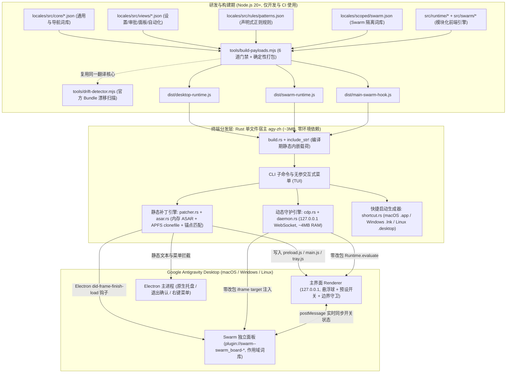
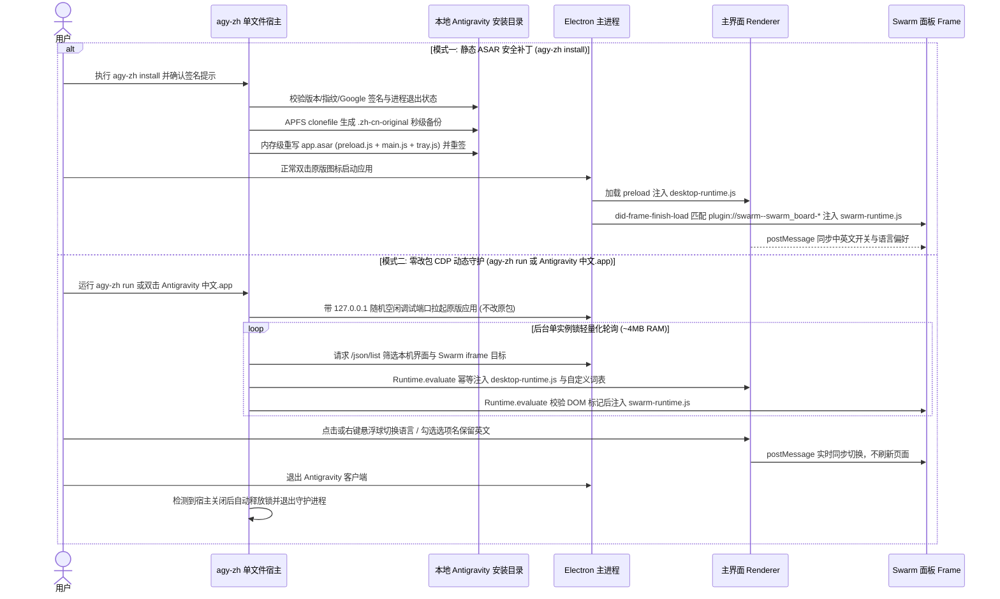

# Google Antigravity Desktop 汉化重构实施计划（v3.0）

## 重构目标与背景

本项目严格聚焦且仅针对 **Google Antigravity Desktop**（macOS / Windows / Linux 桌面客户端，**不包含** Antigravity IDE、VS Code 扩展与 Antigravity CLI）进行架构重构。本次重构保留现有仓库严格的签名与防误译安全底线，并吸收 `yiheng8023/antigravity-chinese` 的分层词库/Swarm 作用域隔离设计与 `yuexps/Antigravity-Hans` 的零改包 CDP 动态守护/单文件分发优势：

1. **双模汉化架构（静态安全补丁 + 零改包 CDP 动态守护）**：
   - **模式一：静态 ASAR 安全补丁（`agy-zh install`）**：保留内存级二进制 ASAR 块哈希重写、macOS `ElectronAsarIntegrity` 哈希同步与 `com.apple.security.cs.disable-library-validation` 本地重签；将 macOS 备份升级为 **APFS `clonefile` 写时复制**（515 MB 应用包秒级零额外磁盘备份）；引入**分层弹性版本兼容**（已验证版本核对参考指纹，未收录小版本采用结构锚点弹性注入），完整覆盖主界面、Swarm 独立面板、Electron 原生托盘、退出确认框与会话右键菜单。
   - **模式二：零改包 CDP 动态守护（`agy-zh run` / `agy-zh shortcut`）**：完全不修改 `Antigravity.app` 原包，保留 Google 官方签名与 Apple 公证，客户端自动升级不掉汉化；通过 `127.0.0.1` 本地调试端口动态注入主界面与 Swarm 子帧，后台常驻内存约 **3–5 MB RAM**，支持一键生成桌面快捷方式或 macOS `Antigravity 中文.app` 包装应用。
2. **Rust 跨平台单文件宿主 + 模块化 JS 注入层**：
   - 移除原有 `Python + Node.js` 运行期双栈割裂，使用纯 Rust 构建 **~2.5–4 MB 零外部环境依赖的单文件可执行程序 `agy-zh`**，在编译期通过 `include_str!` 静态内嵌编译后的前端载荷；CDP 守护采用同步轻量 `tungstenite`（关闭默认 TLS 特性，纯本地回环 TCP WebSocket），不引入重型异步运行时或 C 交叉编译依赖。
   - 研发与 CI 阶段保留轻量 Node.js ESM 工具链，负责三层词库门禁编译、模块化 JS 运行时打包、`jsdom` 防误译回归测试与官方客户端 Bundle 漂移检测。
3. **全方位体验与可维护性升级**：
   - 拆解 1,246 行单文件 [runtime.js](file:///Users/zhangsubo/orca/workspaces/antigravity-chinese-patch/leatherback/src/runtime.js) 与 1,873 条扁平词典 [zh-CN.json](file:///Users/zhangsubo/orca/workspaces/antigravity-chinese-patch/leatherback/locales/zh-CN.json)，建立分层词库源与 6 道编译质量门禁；
   - 补齐内置 **Swarm 面板**（`plugin://swarm--swarm_board-[a-z0-9]+/` 独立文档帧）作用域隔离汉化，并通过 `postMessage` 与主窗口实时同步中英切换；
   - 升级为**可拖拽记忆位置的新一代悬浮控制球**，支持多窗口 `localStorage` 状态同步、右键/双击开启**「选项名保留英文」**预设开关，以及可选 `custom-translations.txt` 用户自定义词表；
   - 清理 `__teacherxu_antigravity_zh__`、`TeacherXuAI`、`antigravity-zh-cn` 历史遗留命名，统一至 `antigravity-chinese-patch`，同时 **100% 兼容识别与无损还原存量 `.zh-cn-original` / `.zh-cn-state.json` 备份**。

---

## 系统架构与双模工作流图

### 1. 总体三层架构图



### 2. 双模运行与注入时序图



---

## User Review Required

> [!IMPORTANT]
> **1. 版本号规范升级为标准 SemVer `3.0.0`**
> 原仓库采用四段式版本号（如 `2.32.1.3`），但 Rust `Cargo.toml` 强制要求三段式标准 SemVer 2.0（四段式无法通过 Cargo 解析），且重构后工具同时支持弹性跨版本与 CDP 动态模式，不再与单一客户端版本强绑定。建议将 `Cargo.toml`、[package.json](file:///Users/zhangsubo/orca/workspaces/antigravity-chinese-patch/leatherback/package.json) 与运行时版本统一升级为 **`3.0.0`**，同时在 [compatibility.json](file:///Users/zhangsubo/orca/workspaces/antigravity-chinese-patch/leatherback/tools/compatibility.json) 与 `doctor` 报告中记录 `verified_desktop_versions: ["2.22.0", "2.23.0", "2.29.1", "2.31.2", "2.32.1"]`。

> [!WARNING]
> **2. CLI 入口替换与老用户存量备份无缝兼容**
> - 移除 [patcher.py](file:///Users/zhangsubo/orca/workspaces/antigravity-chinese-patch/leatherback/tools/patcher.py)，核心入口统一为 Rust 单文件二进制 **`agy-zh`**（Release 资产名规划为 `agy-zh-<os>-<arch>`，开发阶段可通过 `cargo run --` 调用）。
> - 原有 `doctor`、`install`、`restore` 子命令及安全确认参数（`--app`、`--acknowledge-signature-change`、`--allow-local-library-loading`、`--replace-stale-backup`）**全部原样保留**。
> - 新增动态模式子命令：`run`（启动或附着 CDP 动态汉化）、`stop`（停止后台 CDP 监视器）、`shortcut`（生成中文快捷方式 / macOS `.app` 包装器）；无参数运行则进入交互式数字菜单。
> - **存量备份保护**：新版 `agy-zh` 将 100% 兼容识别现有 `<App>.zh-cn-original`、`<App>.zh-cn-state.json`（`schema: 1`）及旧版 `/* TeacherXuAI Antigravity Chinese UI` 补丁标记，老用户无需提前手动清理即可直接 `doctor` 或 `restore`。

> [!NOTE]
> **3. 静态模式 vs 动态模式的覆盖边界**
> - **静态 ASAR 模式（`agy-zh install`）**：覆盖主界面、Swarm 面板、Electron 原生退出确认框、托盘菜单与会话右键菜单，启动原图标即可生效；macOS 需本地重签。
> - **动态 CDP 模式（`agy-zh run` / `agy-zh shortcut`）**：零修改原包、保留 Google 官方签名与 Apple 公证、官方自动更新永不失效；覆盖主界面全部 DOM 与 Swarm 面板，但不修改 Electron 主进程原生托盘和原生退出确认弹窗。

---

## Proposed Changes

### 一、三层模块化词库与编译门禁（`locales/` & `tools/`）

拆解原有的扁平词典与硬编码动态正则，建立分层维护结构并加入 6 道质量门禁与漂移检测工具。

#### [DELETE] [zh-CN.json](file:///Users/zhangsubo/orca/workspaces/antigravity-chinese-patch/leatherback/locales/zh-CN.json)
- 移除旧版单文件扁平词库，统一由 `locales/src/` 与 `locales/scoped/` 经编译器生成产物。

#### [NEW] `locales/src/core/common.json` & `locales/src/core/navigation.json`
- 存放跨视图通用按钮/状态词条，以及侧边栏、Linux `title-menu-bar`、首次登录引导页、历史会话页、项目/分支/工作树选择器词条。

#### [NEW] `locales/src/views/settings.json`、`chat-permissions.json`、`panels.json`、`automations-plugins.json`
- 按界面模块无损拆分现有 1,873 条已实测词条，便于独立增补与 Code Review。

#### [NEW] `locales/src/rules/patterns.json`
- 将 [runtime.js](file:///Users/zhangsubo/orca/workspaces/antigravity-chinese-patch/leatherback/src/runtime.js#L135-L403) 中的纯模板型正则规则外置为声明式 JSON 数组（如 `Available AI Credits`、`files changed`、`Step X of Y`、`Resets in` 等），保留需要复杂单位换算的 `formatDuration` / `formatLimitName` 在共享翻译器中协同处理。

#### [NEW] `locales/scoped/swarm.json`
- 专为内置 `plugin://swarm--swarm_board-<id>/` 独立文档设计的隔离词库：包含显式白名单 `selectors`、`attributeSelectors`、`protectedRoots`（严格保护 `#ov-frame`、`#raw`、`#swarm-title`、`.msg-body`、讲述者自定义 `SwarmHive.viewCopy`、成员名、`@all` 与 `/swarm` 命令）及 ~115+ 条 Swarm 面板专用词条，确保 `Live`、`Board` 等短词绝不泄漏到主界面词库。

#### [NEW] `tools/build-payloads.mjs`
- 零第三方运行时依赖的词库编译与前端打包脚本，内置 **6 道质量门禁**：
  1. **Trim & Non-Empty Gate**：禁止首尾空白 Key 或空译文；
  2. **Duplicate Key Gate**：跨分类文件出现重复英文 Key 时阻断构建并定位冲突文件；
  3. **ASCII / Markup Gate**：拦截包含 `<` / `>` HTML 标签的危险译文及误入汉字的精确 Key；
  4. **Regex Syntax & Double-Escape Gate**：编译校验所有 `patterns.json` 正则并拦截 `\\d` / `\\s` 双重转义笔误；
  5. **Capture-Group Invariant Gate**：校验正则真实捕获组数量与 `replacement` 中 `$1..$n` 引用严格守恒；
  6. **Deterministic Bundle Gate**：固定键序输出 `dist/zh-CN.bundle.json`、`dist/desktop-runtime.js`、`dist/swarm-runtime.js` 与 `dist/main-swarm-hook.js`，保证跨平台构建字节级一致。

#### [NEW] `tools/drift-detector.mjs`
- 支持直接传入新版官方前端 JS bundle 或只读 `app.asar` 文件，提取候选 UI 文案并调用同一套 `translator.js` 引擎模拟翻译，输出未覆盖候选文本列表、中英混排假阳性残留告警及覆盖统计报告 JSON。

---

### 二、模块化前端注入运行时与新一代交互（`src/`）

重构 1,246 行单文件 [runtime.js](file:///Users/zhangsubo/orca/workspaces/antigravity-chinese-patch/leatherback/src/runtime.js)，保留全部已验证防误译边界，补齐热更新清理、新一代悬浮球与 Swarm 跨帧联动。

#### [DELETE] [runtime.js](file:///Users/zhangsubo/orca/workspaces/antigravity-chinese-patch/leatherback/src/runtime.js) & [antigravity-zh-cn.js](file:///Users/zhangsubo/orca/workspaces/antigravity-chinese-patch/leatherback/dist/antigravity-zh-cn.js)
- 拆分为高内聚 ES 模块，并由 `tools/build-payloads.mjs` 打包输出至 `dist/`：

#### [NEW] `src/shared/constants.js`
- 定义统一全局挂载命名空间 `window.__antigravity_chinese_patch__`（注入时若检测到旧版 `window.__teacherxu_antigravity_zh__` 或上一版本实例，先调用其清理方法安全还原原文后再接管）、`localStorage` 键名与跨帧消息频道常量。

#### [NEW] `src/shared/translator.js`
- 四级优先级统一翻译管线：
  1. **用户自定义词表（`window.__agyZhCustomTranslations`）**：支持 `原文 = 自定义译文` 或 `原文 = `（置空强制保留英文）；
  2. **「选项名保留英文」预设开关**：开启时保留 `This Conversation` / `Request Review` / `Default` / `Auto` / `Turbo` 与推理强度 `High` / `Medium` / `Low` 英文原文，说明文案照常翻译；
  3. **精确词典（`exact`）** 与上下文特判（如胶囊徽章 `New`）；
  4. **声明式正则规则（`patterns`）** 与时长/配额组合格式化器，内置容量上限 `Map` 缓存与纯符号/纯中文 O(1) 短路退出。

#### [NEW] `src/runtime/guards.js`、`src/runtime/scanner.js`、`src/runtime/menu.js`、`src/runtime/index.js`
- `guards.js`：集中维护 `SKIP`、`CONTENT`、`protectedNode()`、`inlineConcat` 拼接保护、`isPermissionCard()` 双重结构校验；
- `scanner.js`：将原本堆叠在单个 `scan()` 中的逻辑按界面区域拆分为独立扫描器注册表（设置中心、侧边栏、对话审批流、右侧与底部面板、自动化与扩展市场、向导与弹窗），并将原文记录存入挂载于 `window` 的 `WeakMap`，支持热更新重入时无损还原；
- `menu.js`：导出 `translateMenu(items)` 供静态模式下 Electron `preload.js` 原生右键菜单拦截调用。

#### [NEW] `src/runtime/floating-ball.js`
- 新一代半透明悬浮控制球（`[data-agy-zh-control]`）：
  - **交互**：单击切换 `中` / `EN`；拖拽移动至任意位置并自动吸附限制在可视区域内（随窗口 `resize` 防越界）；
  - **配置弹层**：右键或双击展开菜单，支持语言切换、勾选**「选项名保留英文」**预设开关，以及查看当前运行模式（静态补丁 / CDP 动态）与版本号；
  - **多窗同步**：持久化到 `localStorage`，监听 `storage` 事件实现多窗口实时同步，并通过 `postMessage` 实时同步到页面内 Swarm `iframe`。

#### [NEW] `src/swarm/swarm-i18n.js` & `src/swarm/main-frame-hook.js`
- `swarm-i18n.js`：二次核验 `location.protocol === 'plugin:'`、`^swarm--swarm_board-[a-z0-9]+$` 与 `[data-testid="swarm-tabs"]` + `[data-testid="swarm-empty-state"]` 结构标记，仅翻译白名单选择器直接文本与 `title`/`aria-label`/`placeholder`，监听父窗口 `postMessage` 实时切换中英文；
- `main-frame-hook.js`：供静态补丁注入 `dist/main.js` 的幂等钩子，通过 Electron `webContents` `did-frame-finish-load` + `webFrameMain.fromId` 向匹配的内置 Swarm 子帧自动注入 `swarm-runtime.js`（严禁输出含鉴权查询参数的 URL）。

---

### 三、Rust 跨平台单文件宿主引擎（`Cargo.toml` & `rust-src/`）

#### [DELETE] [patcher.py](file:///Users/zhangsubo/orca/workspaces/antigravity-chinese-patch/leatherback/tools/patcher.py)

#### [NEW] `Cargo.toml` & `build.rs`
- 包名：`antigravity-chinese-patch`，产物名：`agy-zh`，版本：`3.0.0`，Edition `2021`（MSRV `1.80+`）。
- 精简纯 Rust 依赖：`clap`、`serde` + `serde_json`、`sha2` + `hex`、`plist`、`tungstenite`（`default-features = false`，纯本地回环 TCP WebSocket）、Unix `libc` / Windows `windows-sys`。
- `build.rs`：编译期校验 `dist/` 载荷与 `tools/compatibility.json` 完整性，计算并注入内嵌脚本 SHA-256 指纹常量。

#### [MODIFY] [compatibility.json](file:///Users/zhangsubo/orca/workspaces/antigravity-chinese-patch/leatherback/tools/compatibility.json) & [NEW] `rust-src/compatibility.rs`
- 升级为 **Schema v2 分层弹性兼容清单**：
  - `verified_versions`：保留 `2.22.0`、`2.23.0`、`2.29.1`、`2.31.2`、`2.32.1` 的精确指纹参考；
  - `anchor_rules`：对未收录新版 Desktop（先严格核验 `CFBundleIdentifier == "com.google.antigravity"` 或 `package.json` `name == "antigravity" && productName == "Antigravity"`，拒绝一切 IDE/VS Code）执行**结构锚点弹性注入**：`dist/preload.js` 为必选锚点，主进程 `main.js` / `tray.js` / `menu.js` / `updater.js` 锚点唯一匹配则注入，不匹配则温和跳过并记录于 `doctor` / 安装报告中。

#### [NEW] `rust-src/asar.rs`、`rust-src/platform.rs`、`rust-src/patcher.rs`
- `asar.rs`：内存级 ASAR Pickle 解析与批量改写，自动重算 4MB 分块 SHA-256 `integrity`，严格校验并拒绝路径穿越、符号链接及 `unpacked` 外置文件篡改；
- `platform.rs`：跨平台默认安装路径探测（macOS / Windows / Linux）、符号链接与 Windows Junction 越界检查、运行中进程识别与防自杀保护（检测到运行在 Antigravity 智能体会话环境时禁止自动强杀宿主进程）；
- `patcher.rs`：macOS 优先使用 APFS `clonefile` 秒级写时复制备份（失败回退 `ditto`），校验原版 Google LLC 签名与 `spctl` 公证，同步 `ElectronAsarIntegrity`，附加 `com.apple.security.cs.disable-library-validation` 重签并 `--deep --strict` 复验；完整支持两阶段原子替换、`--replace-stale-backup` 及旧版 `schema: 1` / `TeacherXuAI` 状态无缝还原。

#### [NEW] `rust-src/cdp.rs`、`rust-src/daemon.rs`、`rust-src/shortcut.rs`、`rust-src/custom_dict.rs`、`rust-src/main.rs`
- `cdp.rs` + `daemon.rs`：以 `--remote-debugging-port=<port> --remote-debugging-address=127.0.0.1`（绝不传入高危 `--remote-allow-origins=*`）拉起或附着客户端，单实例文件锁后台常驻，监听 `/json/list` 对本机页面与 `swarm--swarm_board-*` iframe 注入载荷并在宿主退出后自动退出；
- `shortcut.rs`：一键生成/移除 macOS `/Applications/Antigravity 中文.app`（复制原版 `icon.icns`、`LSUIElement=true`、日志写至 `~/Library/Logs/antigravity-chinese-patch.log`）、Windows 桌面 `.lnk` 与 Linux `.desktop`；
- `custom_dict.rs`：安全校验并加载可选 `custom-translations.txt`（限制 <= 512KB、常规文件非越界软链、Unix 属主/权限核验、Windows `--trust-custom-translations`），纯 JSON 数据注入，杜绝脚本执行漏洞；
- `main.rs`：支持无参交互式菜单与 `doctor` / `install` / `restore` / `run` / `stop` / `shortcut` 子命令。

---

### 四、测试矩阵、CI/CD 与文档（`tests/`、`.github/`、文档）

#### [DELETE] [runtime.test.cjs](file:///Users/zhangsubo/orca/workspaces/antigravity-chinese-patch/leatherback/tests/runtime.test.cjs) & [test_patcher.py](file:///Users/zhangsubo/orca/workspaces/antigravity-chinese-patch/leatherback/tests/test_patcher.py)

#### [NEW] `tests/runtime.test.mjs`、`tests/swarm.test.mjs`、`tests/build-and-drift.test.mjs` + Rust `#[cfg(test)]` 测试套件
- 迁移并扩展现有 26 项 DOM 回归测试至新命名空间，补齐悬浮球拖拽钳制、「选项名保留英文」预设切换、多窗口同步、自定义词表覆盖、Swarm 独立面板隔离与跨帧切换、6 道词库门禁与漂移扫描测试；
- Rust 模块内覆盖 ASAR 二进制校验、新旧 `schema: 1/2` 还原、弹性锚点匹配与降级、CDP URL/Swarm 白名单安全校验、快捷方式转义与自定义词表权限测试。

#### [MODIFY] [package.json](file:///Users/zhangsubo/orca/workspaces/antigravity-chinese-patch/leatherback/package.json)、[test.yml](file:///Users/zhangsubo/orca/workspaces/antigravity-chinese-patch/leatherback/.github/workflows/test.yml)、[release.yml](file:///Users/zhangsubo/orca/workspaces/antigravity-chinese-patch/leatherback/.github/workflows/release.yml)、[README.md](file:///Users/zhangsubo/orca/workspaces/antigravity-chinese-patch/leatherback/README.md)、[CONTRIBUTING.md](file:///Users/zhangsubo/orca/workspaces/antigravity-chinese-patch/leatherback/CONTRIBUTING.md)、[CHANGELOG.md](file:///Users/zhangsubo/orca/workspaces/antigravity-chinese-patch/leatherback/CHANGELOG.md)
- 更新版本至 `3.0.0`，CI 矩阵（Ubuntu / macOS / Windows）同步校验词库门禁构建确定性、Node 测试与 `cargo test`；Release 工作流自动产出一键可运行的五架构单文件二进制与 `SHA256SUMS.txt`。

---

## Verification Plan

### Automated Tests
1. **词库门禁与前端载荷确定性构建测试**：
   ```bash
   npm run build:payloads
   node --test tests/*.test.mjs
   ```
   验证全部 1,873+ 主词条及新增 Swarm 词条 100% 通过 6 道质量门禁，DOM 防误译边界、悬浮球、预设开关、自定义词表与 Swarm 跨帧同步单测全量通过。
2. **Rust 宿主单测与 Release 编译**：
   ```bash
   cargo test
   cargo build --release
   ```
   验证 ASAR 块完整性重写、新旧备份（含 `schema: 1` 与 `TeacherXuAI` 旧标记）恢复、分层锚点注入、CDP 目标安全过滤、快捷方式生成测试通过，且生成的 `target/release/agy-zh` 单文件精简无外部动态库依赖。
3. **本机只读与沙盒闭环实测（不中断当前运行中的宿主）**：
   - 运行 `./target/release/agy-zh doctor` 只读诊断本机 `/Applications/Antigravity.app`（当前为 2.32.1 旧版已打补丁状态），确认准确识别旧版标记、备份与状态文件；
   - 对 `/Applications/Antigravity.app.zh-cn-original/Contents/Resources/app.asar` 运行只读 `npm run scan:drift` 验证漂移扫描输出；
   - 在临时沙盒 `.app` 副本与本地模拟 CDP 服务端上实测完整的 `install -> doctor -> restore` 字节一致闭环与动态注入闭环。

### Manual Verification
完成构建与测试后，建议你按以下步骤实机体验验收：
1. 完全退出 Antigravity Desktop 后，运行 `./target/release/agy-zh restore` 验证旧版补丁一键无损还原为 Google 官方签名原版；
2. 运行 `./target/release/agy-zh run`（或执行 `./target/release/agy-zh shortcut` 生成 `/Applications/Antigravity 中文.app` 后双击启动），验证**零改包动态模式**下主界面、可拖拽悬浮球、右键「选项名保留英文」切换以及 Swarm 面板汉化与实时同步；
3. 如偏好静态补丁模式，退出客户端后执行 `./target/release/agy-zh install --acknowledge-signature-change --allow-local-library-loading`，验证 APFS 秒级备份、原生托盘/退出弹窗及 Swarm 面板汉化效果。
